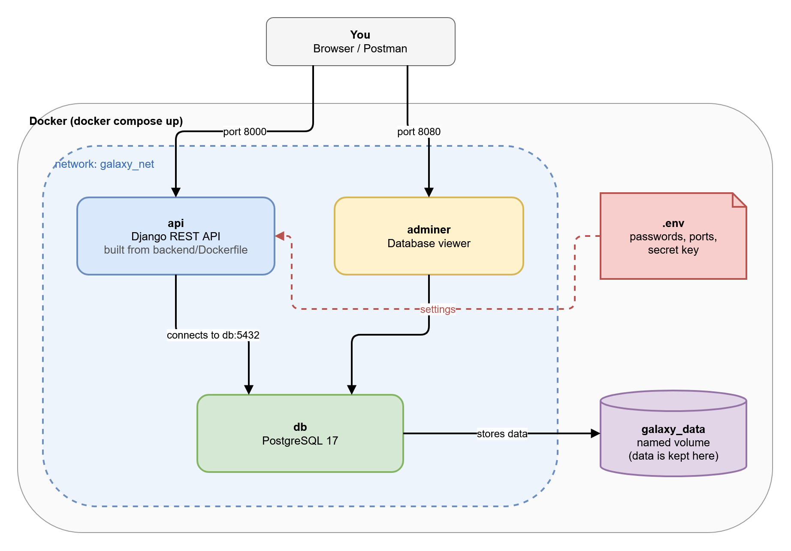
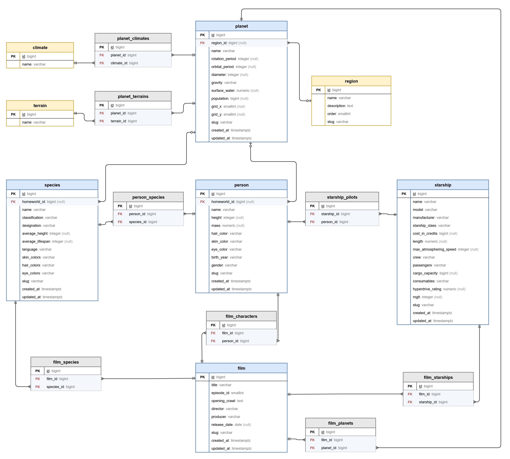

# HoloNet Galactic Atlas API

A Star Wars REST API. Look up planets, see who lives there, which species come from there,
and how far apart two planets are. The data comes from [SWAPI](https://swapi.dev).

**Built with:** Django REST Framework · PostgreSQL · Docker Compose

## How to run

You only need Docker Desktop.

```bash
cp .env.example .env     # skip this if you already have a .env file
docker compose up --build
```

Then open **http://localhost:8000/api/docs/** to see and try every endpoint (Swagger).

| Page | URL |
|---|---|
| API docs (Swagger) | http://localhost:8000/api/docs/ |
| API | http://localhost:8000/api/ |
| Admin panel | http://localhost:8000/admin/ (login and password are in `.env`) |
| Database viewer (Adminer) | http://localhost:8080 (server: `db`, login and password are in `.env`) |

To stop it, run `docker compose down`. Your data is kept. Run `docker compose down -v` to delete it too.

## Main endpoints

| What it does | Request |
|---|---|
| List planets | `GET /api/planets/` |
| Get one planet (by id or name) | `GET /api/planets/1/` or `GET /api/planets/tatooine/` |
| People from a planet | `GET /api/planets/tatooine/people/` |
| Species on a planet | `GET /api/planets/naboo/species/` |
| Distance between two planets | `GET /api/planets/distance/?from=tatooine&to=hoth` |
| ... plus travel time by starship | `GET /api/planets/distance/?from=tatooine&to=hoth&starship=millennium-falcon` |
| Closest planets | `GET /api/planets/coruscant/nearest/` |
| Create / update / delete a planet | `POST /api/planets/`, `PUT` or `PATCH /api/planets/{id}/`, `DELETE /api/planets/{id}/` |

People, species, starships and films have the same create, read, update and delete endpoints.
The full list with examples is in **[docs/API.md](docs/API.md)**.

## Postman

1. In Postman, click **Import** and choose `postman/HoloNet.postman_collection.json`.
2. Start the app with `docker compose up`.
3. Click **Run collection**. All 67 requests have tests and should pass.

## How it works



There are three containers on one Docker network (`galaxy_net`):

- **api** is the Django app, built from `backend/Dockerfile`. It starts only after the database is ready.
- **db** is PostgreSQL. Its data is stored in the named volume `galaxy_data`, so it survives restarts.
- **adminer** is a web page for looking inside the database.

Containers find each other by name. For example, the API connects to the database at host `db`.
All settings (passwords, ports, secret key) are read from the `.env` file.

When the API container starts, it:

1. creates or updates the database tables (`migrate`);
2. loads the Star Wars data if the database is empty;
3. starts the web server (Gunicorn).

## Database



How to read it: **PK** is the primary key, **FK** is a foreign key, and each line starts at the FK column
and ends at the table it points to. `(null)` means the column can be empty.

There are two kinds of links:

- **One-to-many** links are stored as an FK column in the table itself. For example, `person.homeworld_id`
  points to `planet`, and many people can come from one planet. `planet.region_id` and
  `species.homeworld_id` work the same way.
- **Many-to-many** links need an extra table in the middle (the grey tables). For example, a person can pilot
  many starships and a starship can have many pilots, so `starship_pilots` stores one row per pair:
  `(starship_id, person_id)`. Django creates these tables automatically from `ManyToManyField`.

The blue tables are the main data, the yellow tables are short lists of values (regions, climates, terrains),
and the grey tables are many-to-many links. In PostgreSQL every table name starts with `galaxy_`
(for example `galaxy_starship_pilots`).

SWAPI has no planet coordinates, so I added a map position to each planet (for example `"R-16"`).
That position is used to calculate distances. 36 well-known planets have a position. You can add
a position to any other planet with `PATCH /api/planets/{id}/` and `{"grid_square": "N-12"}`.

The SWAPI data was downloaded once and saved in `backend/galaxy/fixtures/galaxy_seed.json`,
so the app does not need the internet to start.

## Project files

| Path | What it is |
|---|---|
| `docker-compose.yml` | the three services, network and volume |
| `.env.example` | template for the `.env` settings file |
| `backend/Dockerfile` | how the API image is built |
| `backend/galaxy/models.py` | database tables |
| `backend/galaxy/views.py` | API endpoints |
| `backend/galaxy/services/navigation.py` | distance and travel time math |
| `docs/` | API documentation and diagrams (open `docs/images/diagrams.drawio` in draw.io to edit them) |
| `postman/` | Postman collection |

## Useful commands

```bash
docker compose exec api python manage.py test galaxy   # run the tests
docker compose logs -f api                             # watch the API logs
docker compose exec db psql -U galaxy -d galaxy        # open a SQL shell
```
